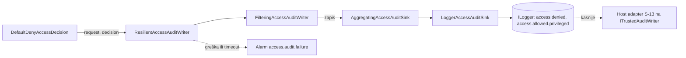
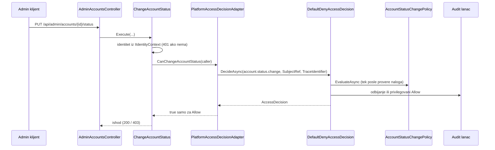

# ACC-05: audit pristupa i usklađivanje modula

| Stavka | Vrednost |
|---|---|
| Tim | Tim 3 |
| Student | PR 16/2023 Musli Danijel (uz Živanović Jovana, ugovori) |
| Zahtevi | ACC-05 (primarno), IDN-03, AUD-01, AUD-03, SEC-02 |
| Projekti | `backend/Platform.Access`, `backend/Platform.Api`, `backend/Platform.Access.Tests`, `backend/Platform.Tests` |
| Status | Faza 1 gotova: audit odbijenih i privilegovanih pristupa, IDN-03 preko centralnog engine-a, testovi da van Development-a nema fake-ova |

Ovaj dokument dopunjava [ACC-05-ACC-08.md](ACC-05-ACC-08.md). Tamo je opis engine-a i fail-closed toka, ovde su audit,
mapa konkurentnih ugovora i recept za module koji se priključuju.

## 1. Šta je urađeno

1. **Audit odbijenih i privilegovanih pristupa.** `IAccessAuditWriter` više nije `NullAccessAuditWriter`, nego lanac dekoratora (odeljak 4).
2. **Usklađivanje IDN-03.** Pravilo "samo administrator menja status naloga" je sada politika u centralnom engine-u, a ne posebna odluka u `Platform.Api` (odeljak 5).
3. **Fallback-deny, deo "nema fake-ova van Development-a".** Samo testovi (odeljak 6).

## 2. Mapa ugovora

Kanonski ugovor za odluku o pristupu je `Platform.Access.Contracts.IAccessDecision`:

```csharp
ValueTask<AccessDecision> DecideAsync(AccessRequest request, CancellationToken cancellationToken = default);
```

Novi modul ne uvodi drugi `IAccessDecision` i ne pravi metodu po akciji. Registruje akciju i politiku (odeljak 3).

| Ugovor | Gde | Vlasnik | Stanje | Dogovor |
|---|---|---|---|---|
| `IAccessDecision` (kanonski) | `Platform.Access.Contracts` | Tim 3 | implementiran, `DefaultDenyAccessDecision` | jedina implementacija u `Platform.*`; test to proverava |
| `IAccessDecision` sa `CanChangeAccountStatus(CallerIdentity)` | `Platform.Api.Services.Identity` | IDN tim (IDN-03) | još koristi `ChangeAccountStatus` | preko `PlatformAccessDecisionAdapter` ide u kanonski; brisanje posle async migracije (odeljak 5) |
| `AdminOnlyAccessDecision` | `Platform.Api.Services.Identity` | IDN tim | ostaje u kodu, host ga ne registruje | obrisati sa adapterom |
| `IAccessDecision` iz LAB-01 (`Decide(IIdentityContext, string, string?)`, globalna `PlatformRole`) | samo grana `feature/LAB-01-skeleton`, nije u `main` | LAB tim | nije integrisan | pri merge-u: ne uvoditi drugi engine, nego akcije i politike po receptu iz odeljka 3 |
| `IAuthoringAccess` | `Platform.Authoring.Application` | Authoring tim (AUT-01/AUT-06) | adapter nije povezan | predlog: adapter koji zove `DecideAsync`, isti obrazac kao `PlatformAccessDecisionAdapter` |
| `IAccessAuditWriter` | `Platform.Access.Contracts` | Tim 3 | lanac dekoratora | odeljak 4 |
| `IAuditWriter` / `ITrustedAuditWriter` | `Platform.Audit.Contracts` | Audit tim (AUD-01) | nema implementacije, `AddAudit()` je prazan | spaja se host adapterom (S-13); `Platform.Access` ne sme da referencira `Platform.Audit` |
| `IAuditWriter` (`Write(AuditEvent)`) | `Platform.Api.Services.Identity` | IDN tim | `LoggerAuditWriter`, piše u log | zaseban audit use-case-a, ne menja se |
| `IIdentityContext` (`CallerIdentity? Current`) | `Platform.Api.Services.Identity` | IDN tim (IDN-02) | `StubIdentityContext` (samo Development) | iz njega adapter pravi `SubjectRef` |
| `IIdentityContext` (`FindByIdAsync`) | `Platform.Identity.Contracts` | IDN tim | postoji | drugi ugovor istog imena, paziti na namespace |
| `IRequestSubjectResolver` | `Platform.Api.Security` | Tim 3 / host | Development i neautentifikovani resolver | koristi ga `POST /api/admin/accounts` |
| `IMembershipReader` | nije u kodu | PS (Tim 3) | planirano | politike članstva čitaju ga kad bude gotov |
| `IResourceDescriptorResolver` | nije u kodu | Faza 2 (ACC-08) | planirano | tek tada `ResourceRef` dobija pouzdan opis resursa |

Modeli Access ugovora su uži nego u analizi zadatka: `SubjectRef(string Id, AccountState State)`,
`AccessRequest(SubjectRef?, string Action, ResourceRef?, string CorrelationId)`,
`AccessDenialReason { None, Unauthenticated, AccountNotActive, UnknownAction, NoPolicy, PolicyError }`.

## 3. Recept: kako modul uključuje svoju akciju

Isti obrazac koriste `RegisterIdentityAccess()` (IDN-01) i `RegisterAccountStatusAccess()` (IDN-03).

1. Odaberi id akcije u formatu `ActionId` (mala slova, tačke, najviše 64 znaka), npr. `account.status.change`.
2. Napiši `IAccessPolicy` sa `Id` (`^[a-z][a-z0-9_.-]{0,63}$`), `Version` (`^v[0-9]{1,4}(\.[0-9]{1,4}){0,2}$`) i
   `EvaluateAsync` koji vraća `bool`. Greška ili izuzetak je odbijanje. Engine već hvata izuzetak politike
   i vraća `PolicyError`.
3. Napiši `Register<Modul>Access(this IServiceProvider)` koji u `InMemoryActionCatalog` upisuje akciju, a u
   `InMemoryAccessPolicyRegistry` politiku. Poziva se u `Program.cs` posle `builder.Build()`, pre prvog zahteva.
   Duplikat baca izuzetak pri startu.
4. Pozivalac pravi `AccessRequest` samo od podataka sa servera (identitet iz sesije, stanje naloga iz baze,
   korelacioni ID sa servera). Identitet, uloga i vlasništvo se **ne** čitaju iz headera, tela ni query stringa.
5. Pozivalac tretira sve osim `Allow` kao odbijanje. Greška, nedostajući podatak i nepoznata akcija nikad nisu dozvola.
6. Dodaj negativne testove: odbijen pristup i nevalidan ulaz.

Privilegovane akcije (zvezdica u analizi) čiji se `Allow` takođe audit-uje:
`lab.revision.publish`, `attempt.review`, `account.status.change`, `system.config.manage`, `results.sensitive.read`.
Lista je trenutno u `AccessAuditOptions.DefaultPrivilegedActions` i zamenjuje je oznaka u katalogu akcija kad je
VS uvede. Poređenje je tačno (ordinalno), bez normalizacije.

## 4. Audit tok



Lanac se sklapa u `AccessServiceCollectionExtensions.AddAccessControl()` kao singleton (nema captive zavisnosti):

| Sloj | Odgovornost |
|---|---|
| `ResilientAccessAuditWriter` | hvata svaki izuzetak, ima sopstveni timeout (podrazumevano 500 ms, nezavisan od tokena zahteva), otkazuje spor upis, diže alarm bez tajni. Greška audit-a nikad ne menja odluku. |
| `FilteringAccessAuditWriter` | svako odbijanje se audit-uje, a `Allow` samo za privilegovane akcije. |
| `AccessAuditRecordFactory` | gradi zapis samo od dozvoljenih polja; nevalidna vrednost se upisuje kao `invalid`, nikad sirova. |
| `AggregatingAccessAuditSink` | isti actor + action + razlog u prozoru od 10 s: prvi zapis odmah, ostali se broje. Privilegovani se nikad ne agregiraju. Najviše 1024 ključa, preko toga se piše pojedinačno. |
| `LoggerAccessAuditSink` | jedan strukturiran `ILogger` zapis: odbijanje je `Warning` (id 6101), privilegovani `Allow` je `Information` (id 6102). |

Polja zapisa: `time`, `actor` (ili `anonymous`/`invalid`), `action`, `target` (`type:id` ili `-`), `outcome`,
`correlationId`, `denialReason`, `policyId`, `policyVersion`, `count`. Ne ulaze telo zahteva, lozinke, tokeni,
identifikatori sesije ni odgovori studenata. Vrednosti su očišćene od kontrolnih i nevidljivih znakova
(zaštita od log injection) i ograničene na 64 znaka. Formati prate katalog `access.denied` u
[audit/CONTRACTS.md](audit/CONTRACTS.md): `denialReason` je snake_case, a `policyId` i `policyVersion` imaju
ugovorene regex-e.

Alarm `access.audit.failure` (id 6103, `Error`) nosi samo razlog (`failed` ili `timed_out`), naziv tipa izuzetka i
očišćen `correlationId`, nikad poruku izuzetka, stek ni sadržaj zapisa.

**Poznata ograničenja:**

- Zbirni zapis poslednjeg prozora izlazi tek sa sledećim odbijanjem (nema tajmera). Bez novog saobraćaja
  brojač poslednjeg prozora ostaje neispisan.
- Ključ agregacije je actor + action + razlog, pa se odbijanja različitih resursa istog korisnika spajaju.
- Odredište je trenutno samo log. Trajni audit (PostgreSQL) čeka host adapter S-13.
- Kad adapter koristi scoped `DbContext`, `IAccessDecision` i `IAccessAuditWriter` moraju postati scoped zajedno
  (vidi [audit/DI-GUIDELINES.md](audit/DI-GUIDELINES.md)). Agregator drži stanje u procesu i mora ostati singleton.

## 5. IDN-03: promena statusa naloga kroz centralni engine



- Akcija: `account.status.change`. Politika: `identity.account.status.change.admin-only`, verzija `v1`
  (`AccountStatusChangePolicy`, administrator preko `IAdminDirectory`, samo kanonski Guid, `Guid.Empty` se odbija).
- `PlatformAccessDecisionAdapter` vraća `true` samo za `Allow`. Svaka greška (engine, repozitorijum, otkazivanje) je `false`.
- Korelacioni ID je `HttpContext.TraceIdentifier`, isti kao u audit liniji use-case-a, pa se zapisi uparuju.
- **Promena ponašanja:** administrator koji je blokiran, arhiviran ili nema nalog u `IAccountRepository` dobija
  403 (`denialReason=account_not_active`). Ranije je bila dovoljna konfiguracija `Stub:AdminIds`.
- `ChangeAccountStatus.Execute` je sinhron, pa adapter blokira nit dok čeka engine, najviše do audit timeout-a.
  Host nema sinhronizacioni kontekst, pa nema deadlock-a.

**Predlog za IDN tim (async migracija):** kad `ChangeAccountStatus` postane asinhron, neka direktno poziva
`Platform.Access.Contracts.IAccessDecision.DecideAsync`, a `PlatformAccessDecisionAdapter`, `AdminOnlyAccessDecision`
i stari `IAccessDecision` se brišu. Politika i registracija ostaju isti.

## 6. Fallback-deny i okruženja

`Platform.Tests/Security/NoFakesOutsideDevelopmentTests.cs` diže pravi host u `Production` i `Staging` i proverava:

- DI daje `UnauthenticatedSubjectResolver`, `AnonymousIdentityContext` i `NoOpSessionRevoker`;
- nijedna registrovana klasa iz `Platform.*` nema u imenu `Stub`, `Fake`, `AllowAll` ni `Development`;
- `/api/access/demo-deny` vraća 404, `X-Stub-User` ne daje identitet, a podešavanja `Identity:DevSubjectId`,
  `Identity:AdminAccountIds` i `Stub:AdminIds` ne daju pristup;
- nema seed naloga, a jedina implementacija `IAccessDecision` je `DefaultDenyAccessDecision`;
- nepoznata akcija, zahtev bez subjekta i akcija bez politike su odbijeni.

Kontrolni testovi nad `Development` hostom potvrđuju da iste provere tamo nalaze fake-ove, pa "nije pronađeno" nešto dokazuje.

Ovo je pokrivenost testovima. Samu implementaciju middleware-a i fallback-deny rute vodi NT.

## 7. Otvorena pitanja

| Pitanje | Vlasnik |
|---|---|
| Katalog `access.denied` nema ključ za brojač agregacije (`count`) | Audit tim |
| Nema tipa događaja za uspešan pristup privilegovanoj akciji (do odluke samo log `access.allowed.privileged`) | Audit tim |
| `SubjectRef.Id` je `string`, a `AuditActor` traži `Guid`; prevod radi host adapter | Audit tim, S-13 |
| Regex u `ActionId.IsValid` koristi `$` umesto `\z` i prihvata `"lab.read\n"`; audit to hvata sopstvenom proverom | VS |
| `DefaultDenyAccessDecision` nema `try/catch` oko audit writera; zaštita je spolja dekoratorom | ZM |
| Engine vraća `PolicyError` kad politika vrati `false`, umesto namenskog razloga | ZM |
| Ko piše adapter između starog i kanonskog `IAccessDecision` (DM ili JZ) | DM / JZ |
| Odeljak "Current state" u `audit/DI-GUIDELINES.md` još pominje `NullAccessAuditWriter` | Audit tim |

## 8. Provera

Iz korena repozitorijuma (isto kao CI):

```bash
dotnet build backend/SecurityLab.slnx --configuration Release
dotnet test backend/SecurityLab.slnx --configuration Release --no-build
```

Ciljano:

```bash
dotnet test backend/Platform.Access.Tests/Platform.Access.Tests.csproj
dotnet test backend/Platform.Tests/Platform.Tests.csproj --filter "FullyQualifiedName~AccountStatus|FullyQualifiedName~PlatformAccessDecisionAdapter|FullyQualifiedName~NoFakesOutsideDevelopment"
```

Ručno (Development):

```bash
cd backend/Platform.Api && ASPNETCORE_ENVIRONMENT=Development dotnet run --urls http://localhost:5080
curl http://localhost:5080/api/access/demo-deny
curl -X PUT -H "X-Stub-User: 11111111-1111-1111-1111-111111111111" -H "Content-Type: application/json" \
  -d '{"status":"BLOCKED"}' http://localhost:5080/api/admin/accounts/22222222-2222-2222-2222-222222222222/status
```

Očekivano: `demo-deny` vraća `Deny` (`UnknownAction`) i u konzoli ostaje jedan `access.denied` zapis (ponovljeni pozivi
se broje, ne ispisuju). Status change sa administratorom vraća 200 i zapis `access.allowed.privileged`. Isti poziv
sa `X-Stub-User: 33333333-3333-3333-3333-333333333333` vraća 403 i zapis `access.denied`.

Testovi po delovima: `Platform.Access.Tests/Auditing/*` (zapis, sanitizacija, filter, agregacija, otpornost, logger),
`Platform.Access.Tests/Composition/*` (lanac u DI-u), `Platform.Tests/Identity/AccountStatus*` i
`PlatformAccessDecisionAdapterTests` (IDN-03), `Platform.Tests/Security/*` (okruženja).
