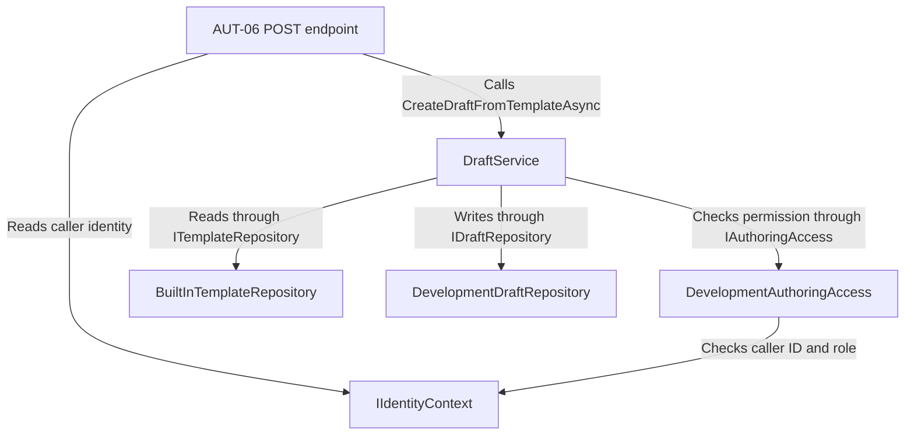
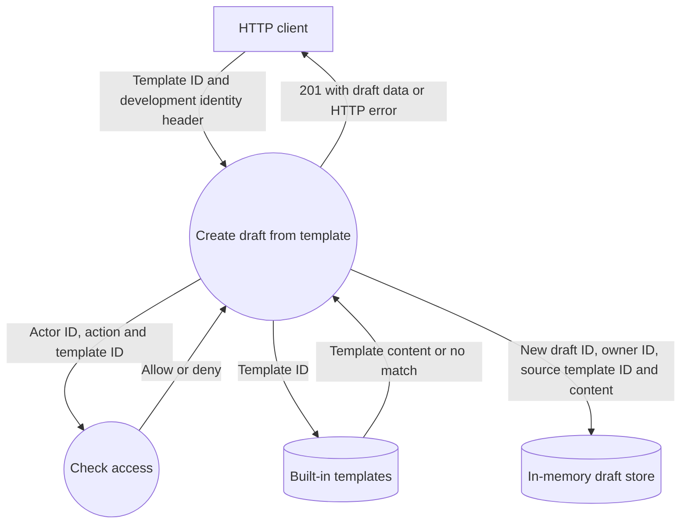

# AUT06 - Creating drafts from a template

The endpoint accepts `POST /api/authoring/templates/{templateId}/drafts`. For KT1, it runs in the DEVELOPMENT environment. It uses the
`X-Test-User` header for development identity, reads from built-in templates and stores created drafts in memory until the application is stopped.

## Component architecture

`Platform.Api` handles the HTTP requests and maps the outcome to a HTTP response
`DraftService` in `Platform.Authoring` checks permissions, loads the template, creates and stores the draft

## Data flow diagram

The endpoint checks the caller identity first. `DraftService` then checks for a permission before reading the template.
A successful request stores a new draft with its own ID and the template's title, goal and lab type. The response contains the created draft.

| Status | Outcome |
|---|---|
| `201 Created` | The API stores and returns the new draft|
|`401 Unauthorized` | The request lacks a valid caller identity|
|`403 Forbidden` | The caller has no permission to create a draft from a template|
|`404 Not Found` | The authorized caller requested a template that doesn't exist|

The `401`, `403` and `404` paths end before a draft is stored

## HTTP verification

`AuthoringHttpTests.cs` covers: successful creation (`201`), an unknown template required by an authorized assistant(`404`) and
an existing template required by a student who has no permission to do so(`403`). Both negative tests verify that the draft store stays empty.