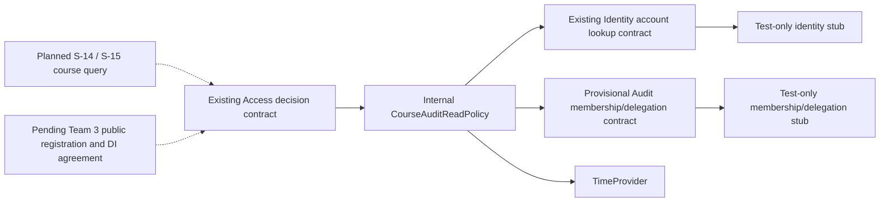
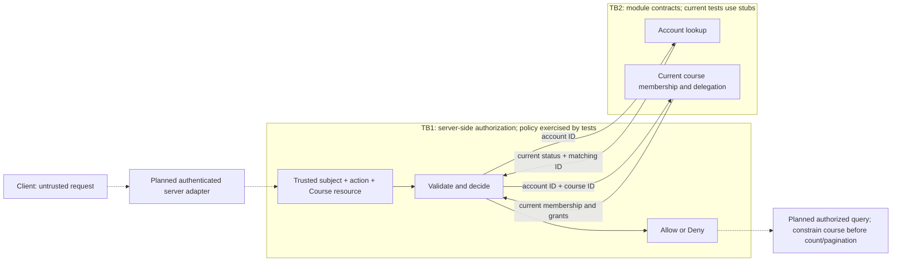

# S-08: course audit read policy

**Team:** 12, Audit component

**Student:** Bojan Kostic (`Bojan763`), member 5

**Story:** S-08

**Requirements:** AUD-06; related ACC-05, ACC-07, SEC-01 and OPS-09

**Status:** policy and test-double contribution for a draft PR. Production registration and
the complete AUD-06 flow remain pending. This document does not declare S-08 integration
or S-15 complete.

## Responsibilities and boundaries

`CourseAuditReadPolicy` implements the existing `Platform.Access.Contracts.IAccessPolicy`
for action `audit.events.read`, resource `Course/<course GUID>`. Its policy ID is
`audit.course.read`, version `v1`. It answers only whether the supplied, server-resolved
subject may read the requested course's audit events. It does not load events, expose an
HTTP endpoint, authenticate a caller, write audit records or read another module's tables.

The implementation is internal to `Platform.Audit.Application.Authorization`. Its public
membership boundary is a provisional Audit contract pending agreement with the
Membership/Delegation owners:

- `ICourseAuditMembershipReader.FindAsync(accountId, courseId, cancellationToken)` returns
  the current membership for exactly one account and course, or `null` if it is unknown.
- `CourseAuditMembership` carries account/course IDs, course role, active state and current
  delegations. The policy checks the returned IDs against the requested IDs.
- `CourseAuditDelegation` carries the grantee account, course, action, validity interval
  and revocation state. It is a snapshot for authorization, not a new delegation system.

The policy uses the existing `Platform.Identity.Contracts.IIdentityContext.FindByIdAsync`
for current account status. Despite its name, this interface is an **account lookup**. It
does not identify the current HTTP caller or validate a session. A future server adapter
must construct `AccessRequest.Subject` from a trusted authenticated context, never from a
client-selected actor ID, role, header or request body. D10 in `DECISIONS.md` is not resolved
by adding this account lookup.

`Platform.Audit.csproj` references `Platform.Access` and `Platform.Identity` to use their
existing contracts. Neither module gains a reverse reference to Audit. Only Audit's
contracts are public; the policy remains internal.

## Decision rules

The policy first requires the exact action `audit.events.read`, a `Course` resource with a
nonempty GUID, and an active subject whose ID is a nonempty GUID. It then reads the current
account and membership on every evaluation; it stores no permission cache or caller state.

| Current server-side state | Result |
|---|---|
| Active account, active Teacher membership in the requested course | Allow |
| Active account, active Assistant membership and a matching valid delegation | Allow |
| Student, unknown role, absent or inactive membership | Deny |
| Teacher in K, Student or no membership in L, request for L | Deny |
| Global administrator without a qualifying course membership | No automatic permission |
| Blocked, archived, unknown or mismatched account | Deny |
| Membership or delegation returned for another account/course | Deny |
| Unknown action, missing/wrong resource or malformed identifier | Deny |
| Provider error, unavailable data or malformed provider data | Deny |

An Assistant's delegation must match the account, course and exact action. Its interval is
`ValidFrom <= now && now < ExpiresAt`, using injected `TimeProvider`. The start is inclusive
and expiry is exclusive. Any non-null `RevokedAt` makes the grant unusable. A grant for a
different action, future grant, expired grant or revoked grant does not authorize reading.
A Student does not gain access merely by carrying a delegation in an invalid snapshot.

Each subsequent decision observes the providers again, so changes to account state,
membership or delegation are applied on the next evaluation. Caller-requested cancellation
propagates as `OperationCanceledException`; it is never converted to permission. Other
provider failures return `false` without exposing exception text or rejected payloads.

## Component architecture

Solid connections below are implemented and exercised in tests. Dashed connections are
planned host/query integration.



The tests exercise the policy directly and through the existing Access decision engine.
Real in-memory Access catalogs are registered only inside the test fixture. This proves
compatibility with the current Access contracts under the test setup; it does not prove
that the production host has registered or invoked this policy.

## Data flow and trust boundaries



TB1 cannot be crossed by trusting a caller-supplied actor or role. TB2 is a logical module
boundary in the same process, not protection from fully compromised server code. There is
no audit database flow in this contribution. Course filtering, DTO field selection,
COUNT/pagination isolation and `audit.events.viewed` belong to later query integration.

## Registration and DI status

`Platform.Access`, `Platform.Api/Program.cs`, CI, `SecurityLab.slnx` and `AddAudit()` are
unchanged by this contribution. No audit read endpoint is exposed and no fake provider is
registered in the running application. Stubs live only in `Platform.Audit.Tests`.

Production registration awaits the Team 3 public composition API and the D2 lifetime
agreement. The current Access decision and registry are singletons. A policy that captures
a scoped account/membership provider must not be stored in that singleton registry. The
complete decision/registry/policy/provider chain needs review; making only the leaf policy
scoped does not fix a captive dependency. The intended future request-scoped policy must
be resolved within a request scope through the agreed composition mechanism.

`Platform.Identity` currently registers its own action through concrete in-memory Access
classes. That existing code is not treated as an accepted public registration API for
Audit and is not copied into Audit production code. No runtime registration or Team 3
acceptance is claimed by the isolated tests.

## Verification and individual evidence

All test subjects, course IDs and delegation grants are synthetic. Authorization tests are
under `backend/Platform.Audit.Tests/Authorization/` and cover these groups:

- Teacher access and cross-course isolation; Student/unknown/inactive membership denial.
- Assistant grants for the exact action/account/course; start/expiry boundaries, revocation
  and unrelated grants.
- Current account status, membership and delegation changes across successive evaluations.
- Invalid request data, mismatched provider results, unavailable providers and cancellation.
- Independent concurrent subjects and compatibility with the existing Access decision flow.

Run from the repository root:

```powershell
dotnet build backend/SecurityLab.slnx --configuration Release
dotnet test backend/Platform.Audit.Tests/Platform.Audit.Tests.csproj --configuration Release --filter "FullyQualifiedName~Authorization"
dotnet test backend/SecurityLab.slnx --configuration Release
```

Record the actual commands, commit SHA, date, executed/pass/fail/skip counts and local/CI
result links in the PR. This document provides no fabricated execution count, commit or PR
URL. A test using stubs proves the policy's behavior against those inputs; it does not
prove real authentication, provider freshness, database permissions or production wiring.

The individual contribution is the policy, provisional membership boundary, test-only
adapters, positive/negative authorization tests and this architecture/DFD explanation.
Bojan must be able to explain why a Teacher in K cannot read L, why delegation is specific
to an action, how expiry/revocation take effect and why provider failure denies access.

## Remaining work and acceptance

Before claiming integrated S-08 completion, review the provisional membership contract
with its owners, implement the real adapters, agree the Team 3 registration/DI design,
wire the policy through that design and execute tests against the real providers. Test
the change-of-rights behavior and concurrent requests after that integration as well.

S-15 still depends on the writer (S-06), S-08, correlation context (S-10), and coordinated
query/endpoint work with S-14. Its responsibilities include enforcing authorization in the
query flow, preventing cross-course data/count leaks and writing `audit.events.viewed`
with agreed failure semantics. They are not implemented or declared complete here.

The future query must also define the consistency boundary between checking permission
and reading data. Fresh lookups on each call do not by themselves provide an atomic
transaction across an authorization check and a later query.
