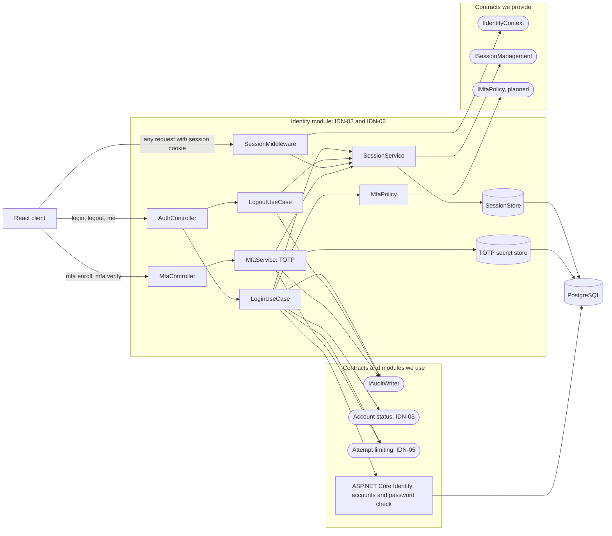
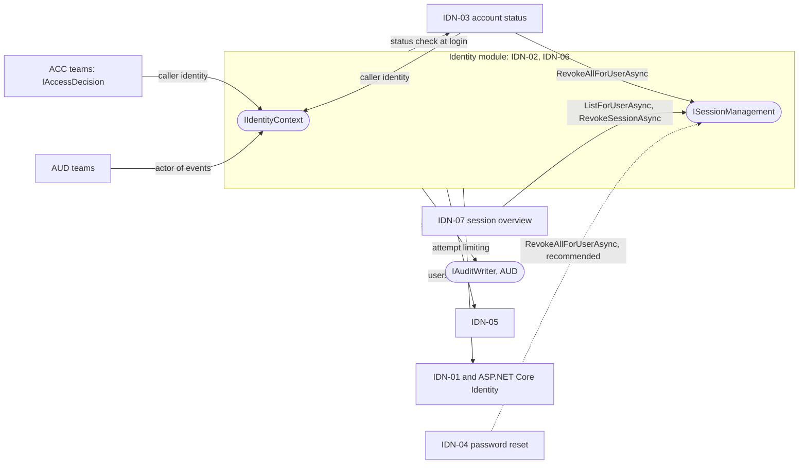
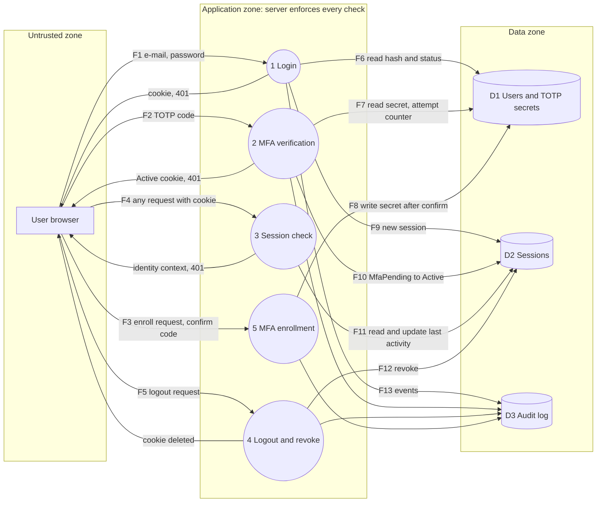

# Project component: IDN-02 Secure login and logout, IDN-06 MFA for selected user groups

**Team:** 1

**Student:** Denis Đuriš / PR 14/2023

**Specification requirements:** IDN-02 (primary), IDN-06, ACC-05, SEC-01, SEC-03, AUD-01, AUD-03. Consumers: IDN-03, IDN-07. Depends on IDN-01 (user entity), IDN-05 (attempt limiting), AUD (`IAuditWriter`) and ADM-02 (migrations).

## Responsibilities and boundaries

- Processes and user scenarios:
  - **Login (IDN-02):** a user logs in with e-mail and password. The server creates a session, the token is sent only in an HttpOnly cookie, the database stores only its hash.
  - **Logout (IDN-02):** the session is revoked in the database and the cookie is deleted. The old cookie then gets `401`.
  - **Session check:** every protected request is checked against the session store, so revoked or expired sessions stop working at once.
  - **MFA enrollment (IDN-06):** a user scans a QR code (TOTP, `otpauth://`) and confirms the first code. The secret is shown only once.
  - **MFA verification (IDN-06):** when MFA is required, login creates a session in the `MfaPending` state that can call only MFA endpoints. A correct code upgrades it to `Active`.
  - **MFA policy:** administrator and teacher must use MFA, student optionally (configurable, proposal pending assistant confirmation).
- Contracts with other modules:

| Contract | Direction | State |
|-|-|-|
| `IIdentityContext` | we provide | draft in `docs/contracts/`, fake implemented |
| `ISessionManagement` | we provide | draft in `docs/contracts/`, in-memory fake implemented |
| `IMfaPolicy` | we provide | **planned**, not in the specification, needs assistant approval |
| `IAuditWriter` | we use, owned by AUD | fake until the audit team delivers |
| Account status | we use, owned by IDN-03 | to be agreed, IDN-03 currently has its own stubs and `ISessionRevoker` |
| Attempt limiting | we use, owned by IDN-05 | to be agreed, minimal own protection until then |
| ASP.NET Core Identity | we use | accounts and password verification, no custom cryptography |

- Not our responsibility: user entity and registration (IDN-01), account status rules (IDN-03), session list screen (IDN-07), shared attempt limiting (IDN-05), audit store (AUD).
- Implementation status:

| Part | Story | State |
|-|-|-|
| Contracts, fakes, module registration | US-01 | done |
| Module skeleton, DbContext, migration | US-02 | done |
| Session model and store | US-03 | done |
| Login, logout, session check | US-04, US-05, US-06 | done |
| MFA enrollment, verification, policy | US-17, US-18, US-19 | planned |

Update this table before KT1 so it matches the real code. The diagrams below show the target design, and only rows marked as implemented exist today.

## Component architecture



Layers: controllers only translate the result into an HTTP code. Use-cases and services hold the rules. `SessionStore` is the replaceable technical part (in-memory fake first, PostgreSQL later). The middleware is the only place that reads the cookie, every other module gets the caller from `IIdentityContext`.

Relations with other modules (solid arrows are agreed or planned dependencies, the dashed arrow is a recommendation that the specification does not require):



## Data flow diagram

Draft, to be confirmed and kept up to date in US-10 and US-28.



Trust boundary: everything from the browser (body, cookies, headers) is untrusted input. Identity and permissions are decided only on the server. The cookie holds a random token, the database holds only its hash. A `MfaPending` session reaches only processes 2 and 5. No audit event contains passwords, tokens, TOTP secrets or codes (AUD-03).

Order of checks on a protected request: session exists, not revoked, not expired, level is `Active`, then the endpoint policy. Anything else returns `401` with no reason.

## Security requirements

- Server-side access checks:
  - Session is verified in the store on every protected request (IDN-02, SEC-01). Hiding screens in the client is not a control.
  - Endpoints without an explicit policy are denied by default (ACC-05).
  - A `MfaPending` session is not authenticated (`IsAuthenticated == false`) and can reach only MFA endpoints, so a privileged account cannot skip the second factor (IDN-06).
  - `ISessionManagement.RevokeSessionAsync` takes the owner id from the server, never from the request, and a foreign or unknown handle gives the same answer.
  - CSRF token required for state-changing requests that use the cookie (SEC-03).
- Input validation and sensitive data:
  - Login answers are identical for a wrong password and an unknown account (no account enumeration).
  - A new session identifier is issued after successful authentication (session fixation).
  - Cookie flags: HttpOnly, Secure, SameSite. Tokens are at least 128 bits from a cryptographic generator.
  - TOTP secret shown once, stored protected, never in logs or API responses. TOTP code cannot be reused in the same time window.
  - Passwords, tokens, TOTP secrets and codes never appear in logs or audit events (AUD-03). Secrets come from user-secrets or environment, never from the repository.
- Negative scenarios (misuse, control, test). Tests marked *planned* are agreed names and will be linked to requirement IDs when written:

| Misuse | Control | Test |
|-|-|-|
| Old cookie used after logout | session revoked in store, `401` | *planned* `OldCookieAfterLogout_Returns401` (US-13) |
| Expired or revoked session | checked on every request | *planned* (US-14, US-24) |
| Wrong password versus unknown account | identical response | *planned* (US-13) |
| Blocked account logs in | no new session | *planned* (US-13, with IDN-03) |
| Privileged user calls API with `MfaPending` session | only MFA endpoints reachable | *planned* `MfaPending_CannotAccessProtectedResource` (US-25) |
| Wrong or repeated TOTP code | rejected, attempts limited, replay refused | *planned* (US-25) |
| CSRF request without token | rejected | *planned* (US-24) |
| Revoking someone else's session | owner check, `false` | `RevokeSession_BelongingToSomeoneElse_ReturnsFalse_SessionStaysActive` |
| Probing which session handles exist | foreign and unknown look the same | `RevokeSession_UnknownHandle_LooksTheSameAsForeignSession` |
| MfaPending treated as logged in | `IsAuthenticated` is false | `MfaPendingSession_IsNotAuthenticated_EvenWithUserId` |
| Token or hash leaks through session list | `SessionInfo` has no such member | `SessionInfo_ExposesNoTokenOrHash` |

## Evidence of work

- Changed files / commit / pull request: branch `feature/IDN-02-safe-login-logout`
  - `docs/contracts/IIdentityContext.md`, `docs/contracts/ISessionManagement.md`
  - `backend/Platform.Api/Services/Identity/Contracts/IdentityContracts.cs`, `IdentityFakes.cs`
  - `backend/Platform.Tests/Identity/IdentityFakesTests.cs`
  - `docs/PROJECT_COMPONENTS.md` (team row), this file
- Run instructions (PowerShell, from the repository root):

```powershell
dotnet build backend\Platform.Api\Platform.Api.csproj
dotnet test backend\Platform.Tests\Platform.Tests.csproj
```

  Login, logout and MFA endpoints do not exist yet. Instructions for the demonstration (seed users, steps, expected results) will be added in US-26 and US-30.
- Next steps:
  1. Agree `IIdentityContext` and the session revoker with IDN-03 (their `ISessionRevoker` stub) and confirm `IMfaPolicy` with the assistant.
  2. US-02 to US-06: skeleton, session store, login, logout, session check.
  3. US-12: record the TOTP decision as an ADR, then US-17 to US-19.
  4. Replace the fakes with the real implementation and run the same contract tests against it (US-16).
  5. Keep this document, diagrams and the status table in line with the code (US-28).
